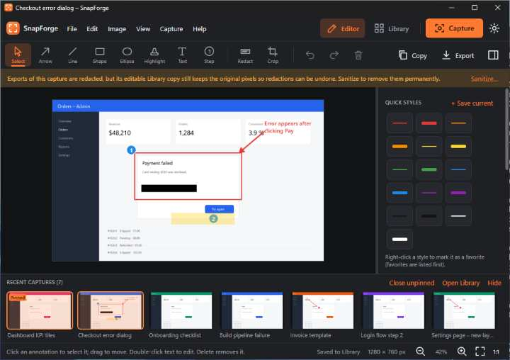
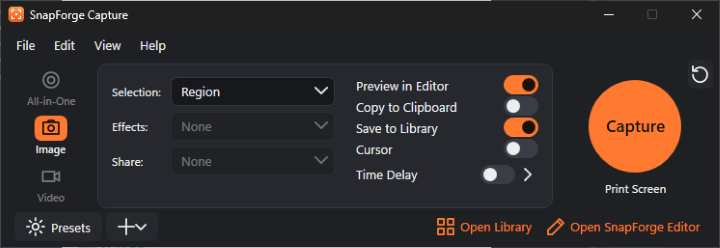

<p align="center"></p>

<p align="center"></p>
<p align="center"></p>

# SnapForge

A free, private screenshot, screen-recording and annotation app for **Windows 11 (24H2 or later, x64)**, built with
C#, .NET 10 and WPF. MIT licensed. No ads, no subscription, no account, no telemetry — everything stays on your PC.

> **Status: 1.0.0 release candidate (`1.0.0-rc.1`) — not approved for public release.** The integration branch is
> `release/v1.0-candidate`. Automated tests run on Windows in CI; manual acceptance on physical Windows 11 PCs, code
> signing and legal review are still pending — see the [release-candidate handoff](docs/RELEASE-CANDIDATE-HANDOFF.md),
> [known limitations](docs/KNOWN-LIMITATIONS.md) and [manual acceptance checklist](docs/MANUAL-ACCEPTANCE-1.0.md).

## Features

* **Capture** — region (with magnifier and arrow-key nudging), window, active window, display, full screen,
  scrolling capture (auto or manual scroll), repeat last capture, new from clipboard; delay, mouse pointer, presets,
  global hotkeys (Print Screen by default; conflicts reported). Multi-monitor and mixed-DPI aware.
* **Capture panel, desktop widget and notification-area icon** — one click to capture or record from anywhere.
* **Editor** — arrow, line, rectangle, ellipse, highlight, text, numbered steps, pen, callout, stamps, redact, blur,
  pixelate, crop; rotate, flip, resize, canvas size, border, drop shadow, watermark; copy/paste/duplicate
  annotations; Quick Styles; undo/redo for every edit; print.
* **Redaction you can trust** — redact replaces pixels with solid black in every export, copy and drag; **Sanitize**
  removes the original pixels from the Library copy too ([details](docs/REDACTION.md)). Blur and pixelate are visual
  effects, not redaction.
* **Extract text (OCR)** — offline, with the recognition languages built into Windows; review, edit and copy.
* **Screen recording** — region, window or display to MP4 (H.264 + AAC) with system sound and microphone, pause/resume,
  floating toolbar kept out of the video, recovery of interrupted recordings.
* **Video editing** — trim, remove sections, step through frames, save a frame as an image, export MP4 or GIF.
* **Library** — every capture saved automatically and stays editable; search, tags, folders, favourites, Trash,
  combine images, import PNG/JPEG/BMP/MP4, backup/restore, retention, movable location ([format](docs/CAPTURE-FORMAT.md)).
* **Output** — PNG, JPEG, BMP, TIFF, MP4, GIF; clipboard; native drag-and-drop of files (flattened, redacted, no
  metadata) — tested with Explorer-style drop targets on CI; Office, Teams and browser targets await manual verification.
* **Private by design** — no network code, standard user rights, local storage under `%LOCALAPPDATA%\SnapForge`.
  See the [threat model](docs/THREAT-MODEL.md) and [security policy](SECURITY.md).

## Keyboard shortcuts

| Action | Keys | Action | Keys |
|--------|------|--------|------|
| Capture (current settings) / Region / Window / Display / Full screen | Ctrl+N / Ctrl+1 / 2 / 3 / 4 | Undo / Redo | Ctrl+Z / Ctrl+Y (Ctrl+Shift+Z) |
| Select / Arrow / Line / Rectangle / Ellipse | V / A / L / R / E | Copy / Export | Ctrl+C / Ctrl+S |
| Highlight / Text / Step / Redact / Crop | H / T / N / X / C | Delete selection | Del |
| Pen / Callout / Stamp / Blur / Pixelate | D / K / S / B / P | Copy / paste / duplicate annotation | Ctrl+Shift+C / Ctrl+V / Ctrl+D |
| Active window / Scrolling capture / Repeat last | Ctrl+5 / Ctrl+6 / Ctrl+R | New from clipboard / Extract text | Ctrl+Shift+V / Ctrl+Shift+T |
| Record / pause / resume, Stop recording | Shift+F9, Shift+F10 | Print | Ctrl+P |
| Editor / Library / Settings | Ctrl+E / Ctrl+L / Ctrl+, | Zoom in / out / fit / 1:1 | Ctrl+= / Ctrl+− / Ctrl+0 / Ctrl+Alt+0 |
| Pin current capture in tray / Close capture | Ctrl+Shift+P / Ctrl+W | Global capture hotkey | Print Screen (configurable) |
| Cancel | Esc (or right-click during capture) | Zoom with wheel | Ctrl+wheel |

## Download a release-candidate build

There is **no public download yet**. For testing, every CI run on `release/v1.0-candidate` publishes
`SnapForge-<version>-packages-<commit>` on the **Actions** run page: a portable ZIP, a per-user installer
(`SnapForge-<version>-setup-win-x64.exe`, no administrator rights), a CycloneDX SBOM and `SHA256SUMS.txt`. The
builds are **unsigned**, so Windows SmartScreen may show a warning; verify the checksum first
(`Get-FileHash <file>`). Help → About shows the version, build number and commit. `SnapForge.exe --self-test
report.txt` runs a non-interactive diagnostic. See [INSTALLATION.md](docs/INSTALLATION.md).

## Build from source

Requires the .NET 10 SDK.

```powershell
dotnet build SnapForge.sln -c Release
dotnet test SnapForge.sln -c Release          # Windows: all tests; Linux/macOS: run tests/SnapForge.Core.Tests
dotnet run --project src/SnapForge.App        # Windows only
dotnet publish src/SnapForge.App -c Release -r win-x64 --self-contained true -p:PublishSingleFile=true -o publish
```

The Windows projects compile on Linux/macOS (`EnableWindowsTargeting`) but run only on Windows.

## Documentation

* **1.0 release candidate:** [handoff](docs/RELEASE-CANDIDATE-HANDOFF.md) · [release notes](docs/RELEASE-NOTES-1.0.0-rc.1.md) · [requirements traceability](docs/PRODUCT-REQUIREMENTS-TRACEABILITY.md) · [defect register](docs/DEFECT-REGISTER.md) · [known limitations](docs/KNOWN-LIMITATIONS.md) · [manual acceptance](docs/MANUAL-ACCEPTANCE-1.0.md) · [benchmarks](docs/BENCHMARKS-1.0.md) · [product inventory](docs/FINAL-PRODUCT-INVENTORY.md)
* **Using SnapForge:** [user guide](docs/USER-GUIDE.md) · [installation](docs/INSTALLATION.md)
* **Security and legal:** [security policy](SECURITY.md) · [threat model](docs/THREAT-MODEL.md) · [security testing](docs/SECURITY-TESTING.md) · [privacy model](docs/SECURITY.md) · [redaction](docs/REDACTION.md) · [licensing review](docs/LICENSING-REVIEW.md) · [dependencies and SBOM](docs/DEPENDENCIES.md) · [third-party notices](THIRD-PARTY-NOTICES.md)
* **Releasing:** [release process](docs/RELEASE-PROCESS.md) · [code signing preparation](docs/SIGNING.md) · [rollback](docs/ROLLBACK.md) · [maintenance](docs/MAINTENANCE.md) · [contributing](CONTRIBUTING.md)
* **Design and history:** [architecture](docs/ARCHITECTURE.md) · [capture format](docs/CAPTURE-FORMAT.md) · [Library video format](docs/LIBRARY-VIDEO-FORMAT.md) · [video architecture](docs/VIDEO-ARCHITECTURE.md) · [video threat model](docs/VIDEO-THREAT-MODEL.md) · [Milestone 3 handoff](docs/MILESTONE-3-HANDOFF.md) · [V1 recording handoff](docs/V1-HANDOFF.md) · [UI testing](docs/UI-TESTING.md) · [research](docs/RESEARCH.md) · [competitive analysis](docs/COMPETITIVE-ANALYSIS.md)

## License

[MIT](LICENSE) — Copyright (c) 2026 bazeocrisy.
