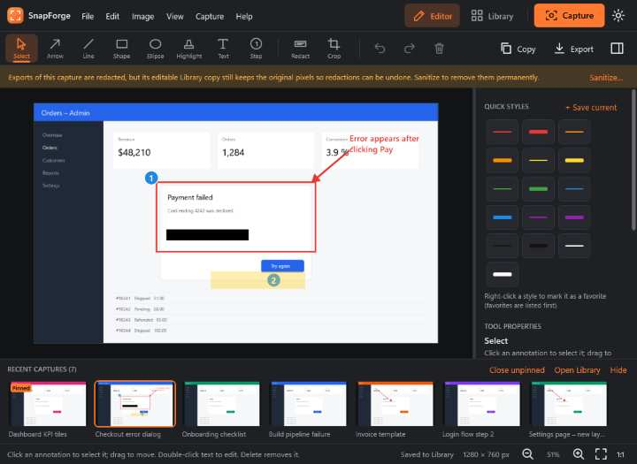
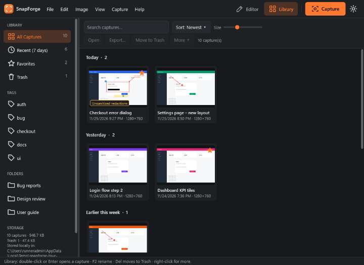
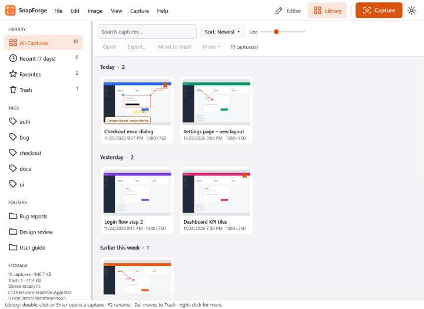
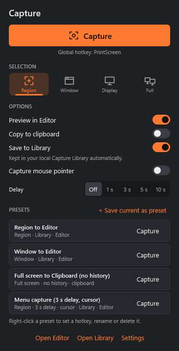
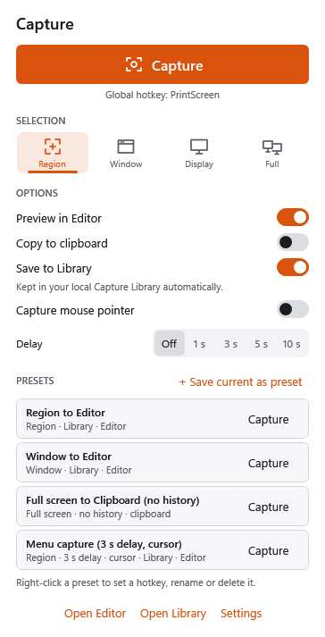
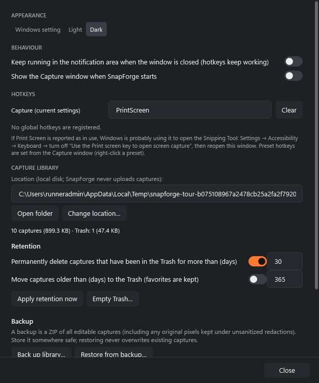

# Screenshots (milestone 2)

Rendered on the GitHub Actions Windows runner by `SnapForge.exe --screenshots` (portable build, with .NET hidden)
from a throw-away demo library of synthetic screenshots, at commit `de60661`. These are reduced JPEG previews
(720 px wide); full-size PNGs are in the CI artifact `screenshots-<commit>`. The runner's desktop is 1024×768, so
windows are shown at that size.

| Workspace | Dark | Light |
|---|---|---|
| Editor (toolbar, canvas, Quick Styles & Tool Properties, Recent Captures Tray, redaction banner) |  |  |
| Library (views, tags, folders, storage, search/sort/size, date groups, badges) |  |  |
| Capture window (modes, options, delay, presets) |  |  |
| Settings (theme, hotkeys, library location, retention, backup, privacy) |  |  |
