# Screenshots (milestone 3)

**Real screen captures**, not renderings: `SnapForge.exe --screenshots` (portable build, .NET hidden) shows each window
on the GitHub Actions Windows runner's desktop and captures the screen pixels with SnapForge's own GDI capture.
Demo library of synthetic screenshots in a temporary folder; commit `bd6ca39`, CI run 45724805609.
The runner's desktop is a single **1024×768** display at 100 % — real PCs will show larger windows. These are reduced
JPEG previews (≤720 px wide); full-size PNGs are in the CI artifact `screenshots-<commit>`. They are automated
evidence (CI), not a substitute for looking at the app on a real PC.

| Surface | Dark | Light |
|---|---|---|
| Capture panel (compact horizontal; Video/All-in-One, Effects, Share disabled "Not available yet") | 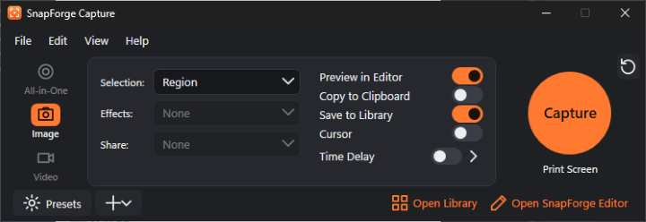 | 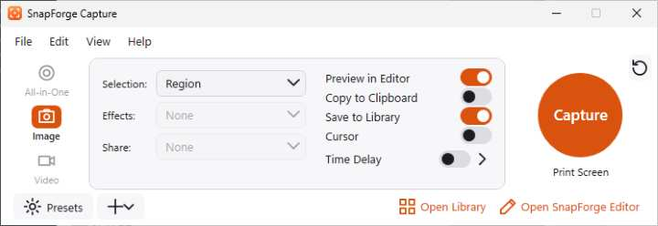 |
| Widget collapsed (top-centre tab) | 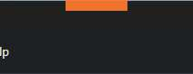 | 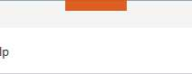 |
| Widget expanded (Capture, Editor, Library, Presets) | 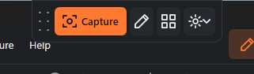 | 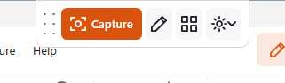 |
| Widget docked on the left edge | 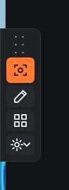 | 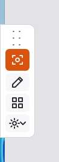 |
| Editor with Recent Captures tray |  | 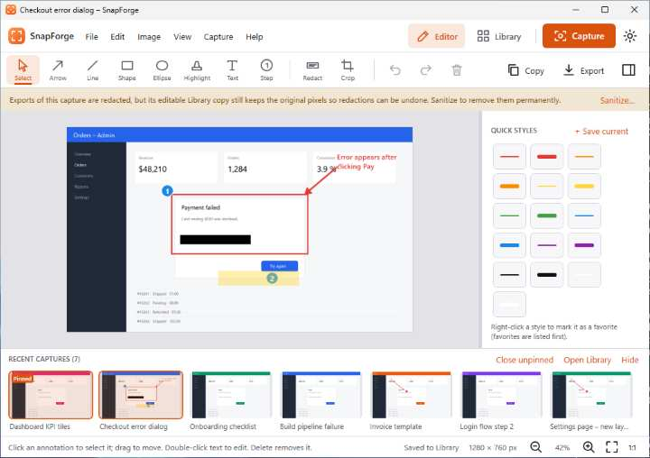 |
| Recent Captures tray, two tiles selected for a multi-capture drag | 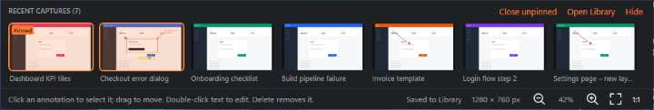 | 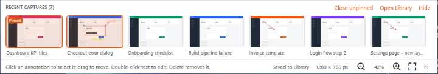 |
| Library with a multi-selection (Import… button, drag-out) |  |  |
| Settings (top) |  |  |
| Settings: capture widget, drag and drop, startup |  | 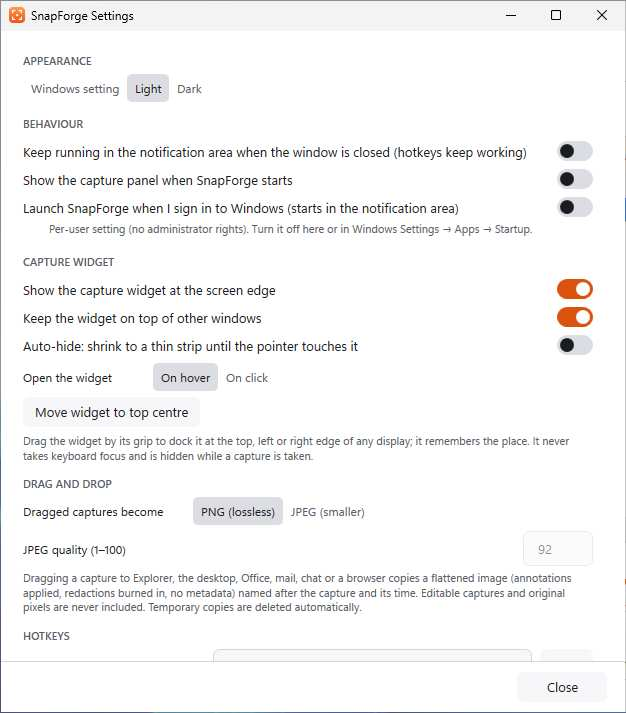 |

A drag in progress cannot be captured this way (the screen capture runs on the same thread as the modal drag loop);
the drag behaviour is covered by real-input tests instead (see the handoff).
