# Screenshots — Milestone V1 screen recording

**Real screen captures** made by `SnapForge.exe --screenshots` on the GitHub Actions Windows runner (single
1024×768 display, 100 %, software rendering), portable build with .NET hidden — commit `7cee382`, CI run
[45910436639](https://github.com/bazeocrisy/SnapForge/actions/runs/45910436639). Reduced JPEG previews (≤720 px);
full-size PNGs are in the CI artifact `screenshots-<commit>`. CI evidence, not a substitute for a real PC.

The demo video is a **real 4-second recording** made by the production recorder during the tour, of a synthetic test
pattern (so the screenshots do not depend on what else is on the runner's screen).

The recording toolbar and outline are excluded from screen capture in the app, so a screenshot cannot show them; for
these documentation images only they are shown **without** the exclusion. That the real toolbar and outline do not
appear in recordings is verified separately by the self-test's pixel check (`toolbar-not-recorded`).

| Surface | Dark | Light |
|---|---|---|
| Capture panel — Video mode (owner defaults: system audio on, microphone off, cursor on, countdown 3 s, 30 FPS, Standard; Record / Shift+F9) | 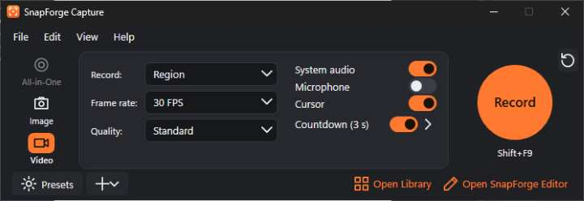 | 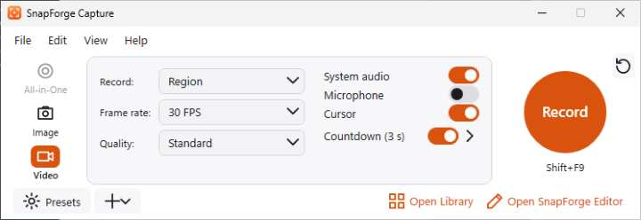 |
| Capture panel — Image mode (unchanged) | 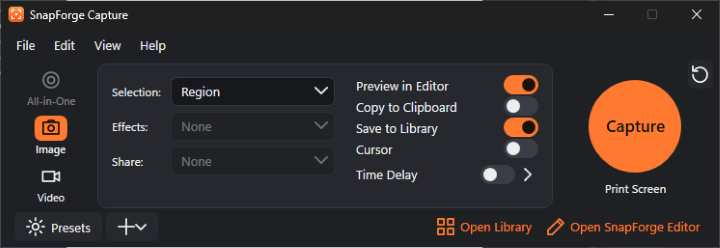 | 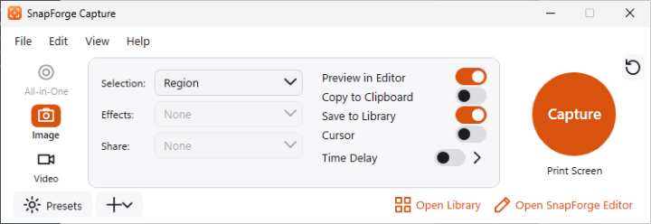 |
| Recording: dashed outline around the recorded area and the floating toolbar | 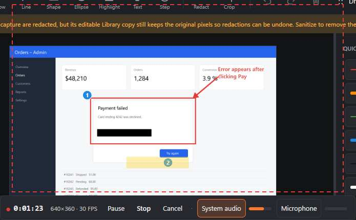 | 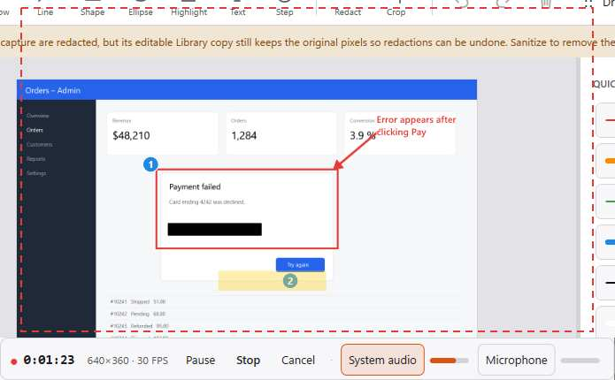 |
| Recording toolbar (elapsed time, size · FPS, Pause, Stop, Cancel, System audio / Microphone with level meters) | 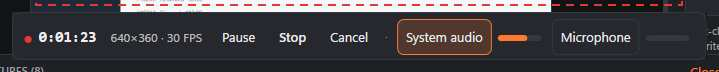 | 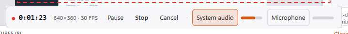 |
| Library — Videos view (play badge, duration) | 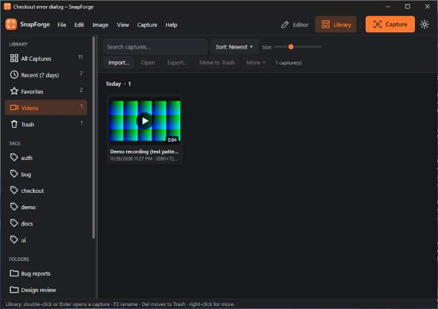 | 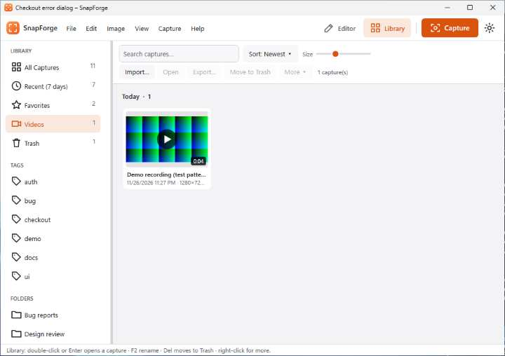 |
| Library — all items (video tile among image captures) | 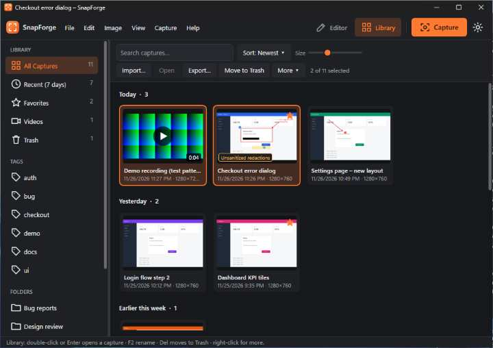 | 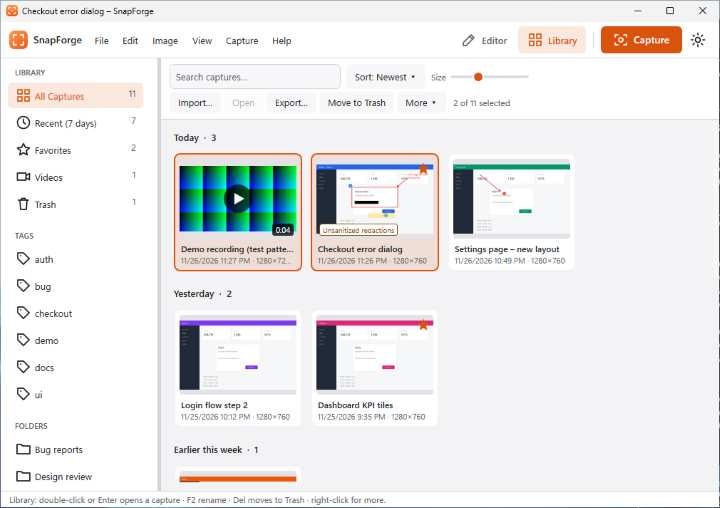 |
| Player (playing; seek bar, time, mute, volume, info line) | 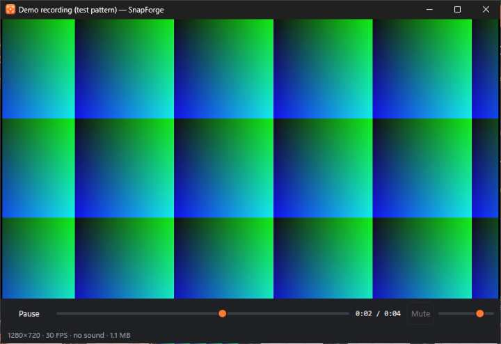 | 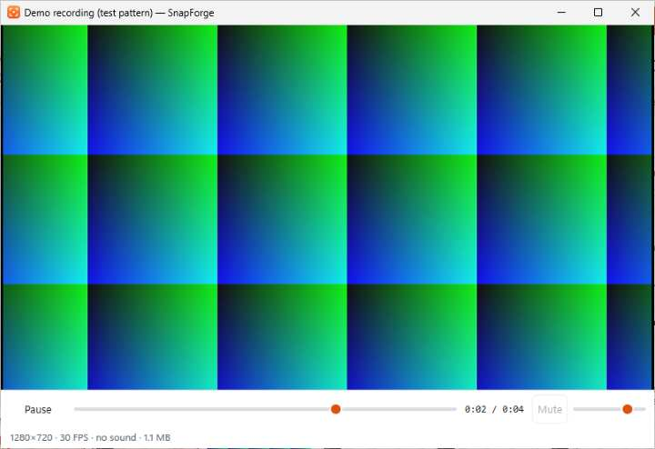 |
| Settings → Recording (microphone, hotkeys, Library, disk space, privacy note) | 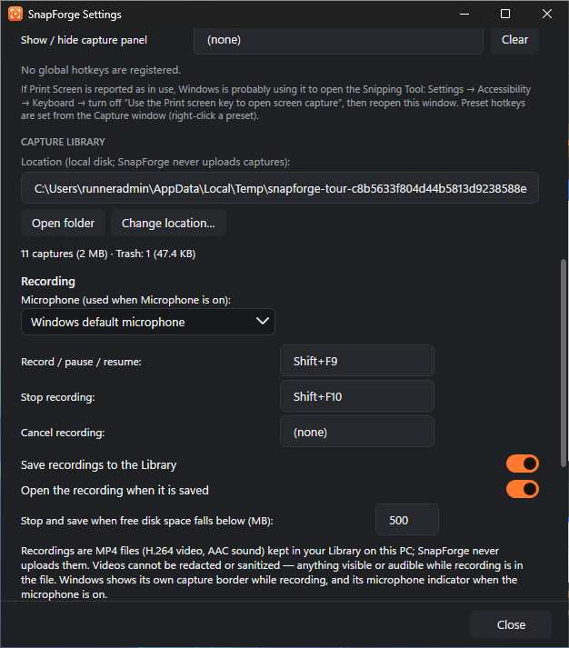 | 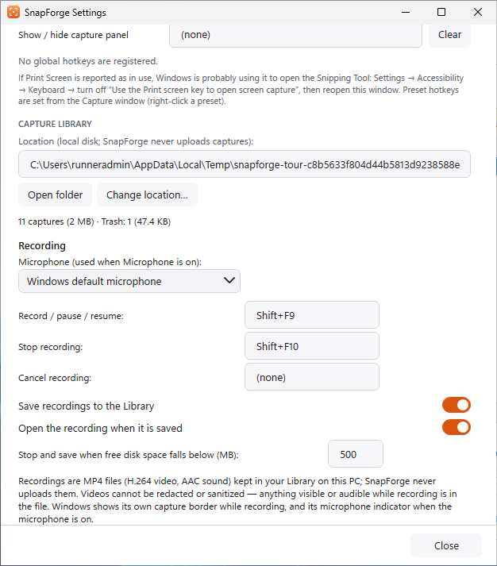 |
| Widget expanded (Capture, **Record**, Editor, Library, Presets) | 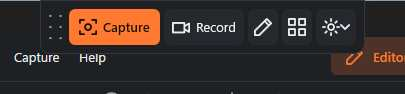 | 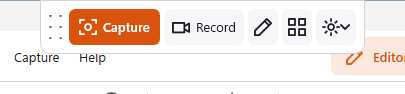 |
| Editor with Recent Captures tray (video in the tray) | 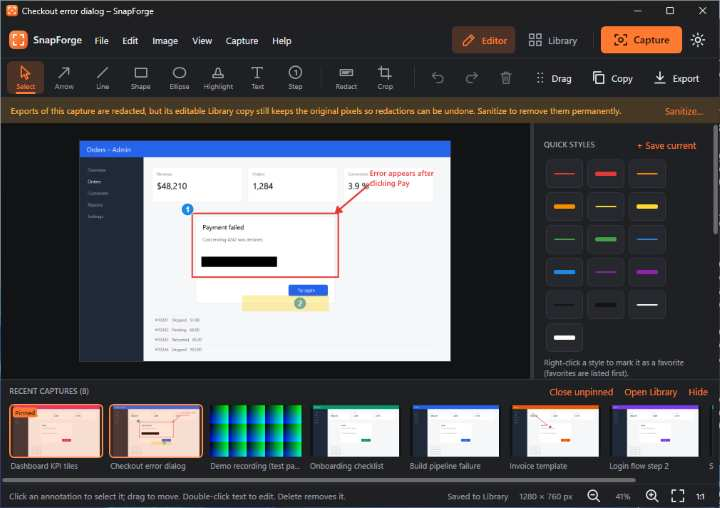 | 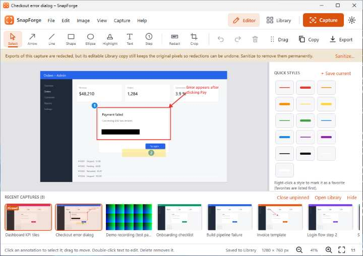 |
| Widget collapsed / docked left | 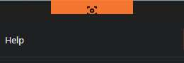 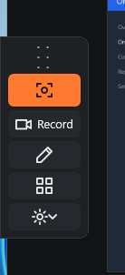 | 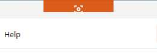 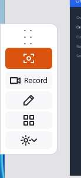 |
| Settings (top) / widget and drag-and-drop | 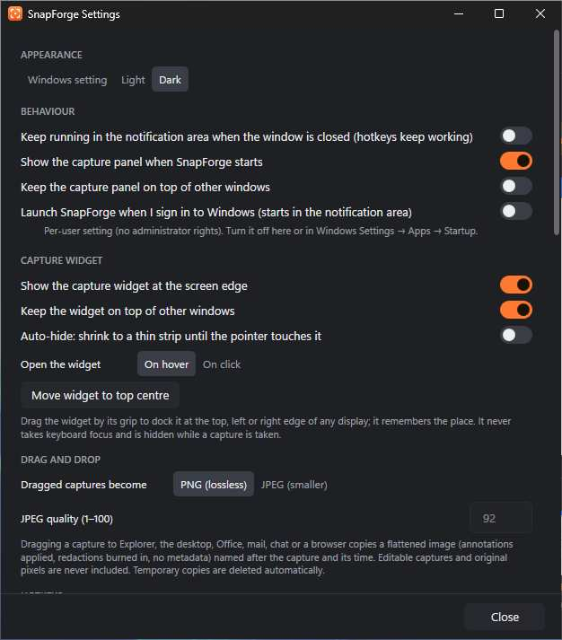  | 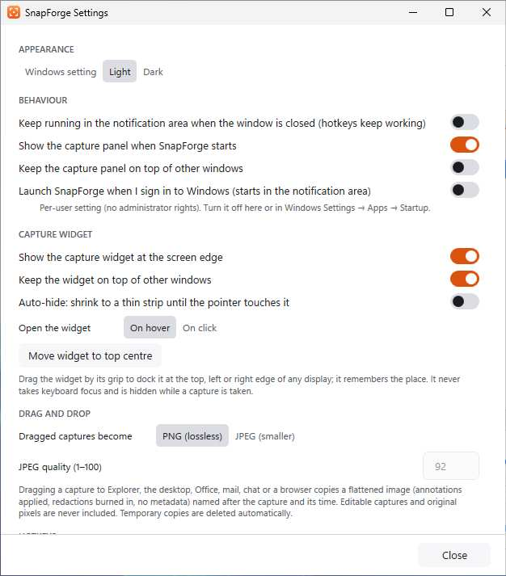  |
